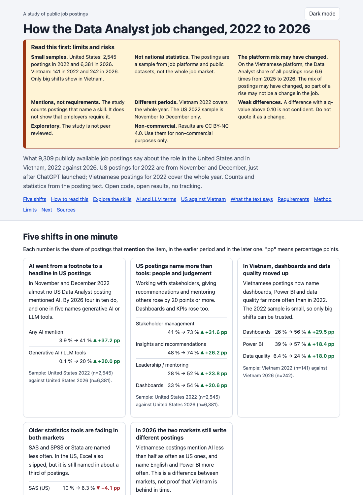
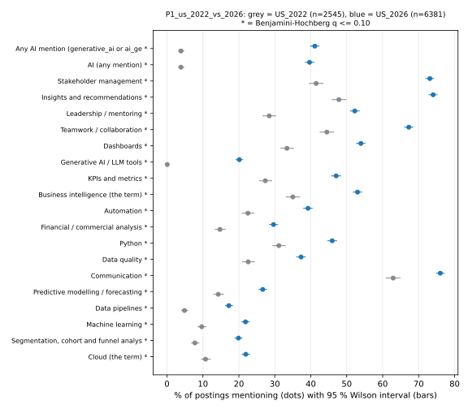
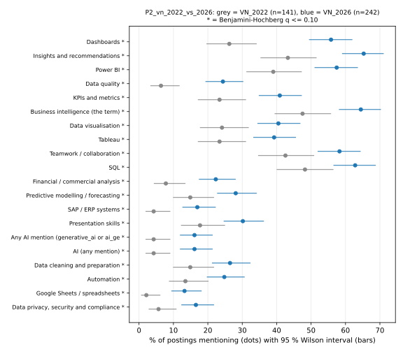
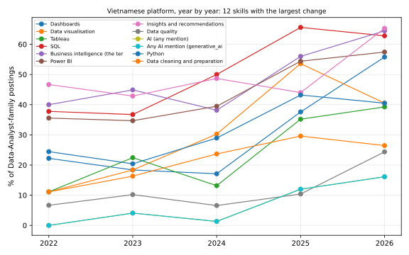
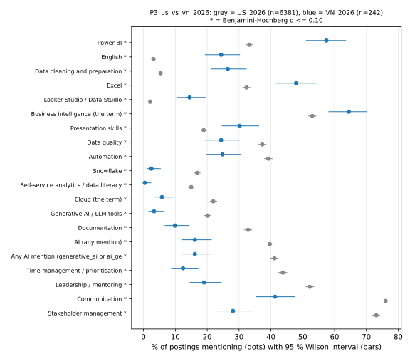

# How the Data Analyst job changed, 2022 to 2026

A text-analysis study of publicly available job postings. It compares what
employers asked of a **Data Analyst** in 2022 and in 2026, in the **United
States** (2022: Nov to Dec) and in **Vietnam** (2022: the whole year). It counts
skills with statistics. It also reads the words themselves with text methods.

**Repository:** `analysis-da-job-shift` (the study is called `da-job-shift`).

**[Open the interactive report](report/index.html)** (one static page: charts, filters, plain-English explanations, no tracking). On github.com this link shows the page source. Once GitHub Pages is on, the page is at `https://<your-user>.github.io/analysis-da-job-shift/` ([docs/PUBLISHING.md](docs/PUBLISHING.md)). To view it now, download the repository and open `report/index.html` in a browser.

**Read this first: limits and risks.** The samples are small (Vietnam 2022: 141 postings, Vietnam 2026: 242). They come from job platforms and are not national statistics. The study counts mentions, not requirements. It is exploratory and not peer reviewed. Results are CC BY-NC 4.0 (non-commercial). Full list: section 6 and the box at the top of the report.

[](report/index.html)

## 1. The question

Between 2022 (ChatGPT launched on 2022-11-30) and 2026, what changed in
what employers ask of a Data Analyst?

1. Which tools, tasks and skills rose or fell?
2. Did the same change happen in the US and in Vietnam?
3. Where does Vietnam stand against the US in 2026?

The evidence is the text of public job postings. No surveys, no interviews.

## 2. Why text analysis as well as numbers

A table of salaries or job counts cannot say what the job asks for. The
answer is inside the posting text. So this project does both:

* **Numbers.** Share of postings that mention a skill, with confidence
  intervals, exact tests and effect sizes.
* **Text.** Rules that read English and Vietnamese text, word-level
  comparisons, and theme models that let the postings group themselves.

The text layer finds things nobody planned to look for. Example: US 2026
postings carry pay-transparency words ("salary range", "base salary"). US 2022
postings carry COVID words ("vaccination", "remote"). A skill count cannot show that.

## 3. Data

| Cell | Postings | Years | n (Data Analyst family) | Language |
|---|---|---|---|---|
| US_2022 | publicly available US job postings | Nov to Dec 2022 | 2,545 | English |
| US_2026 | publicly available US job postings | Jan to Aug 2026 | 6,381 | English |
| VN_2022 | publicly available Vietnamese job postings (45 from a job platform, 96 archived pages) | 2022 | 141 | mostly Vietnamese |
| VN_2026 | publicly available Vietnamese job postings (job platform) | 2026 | 242 | mostly Vietnamese |

A posting counts only if its **title** is in the Data Analyst family
(data analyst, BI analyst, analytics, "phân tích dữ liệu" and close variants).
Data engineer, data scientist and business analyst titles are left out.

**Source data is local only and git-ignored. Nothing raw is committed.** This
repository redistributes nothing but aggregates (counts, rates, statistics,
figures) and holds no posting text. **The download scripts are not published.**
The data is publicly available job postings (Vietnam and US, 2022 and 2026). To
rerun the pipeline, get your own copy and put it in the folders listed in
[DATA_SOURCES.md](DATA_SOURCES.md) ("Folder layout for your own copy"). That file
also has credits, licences and sizes.

## 4. Method in 5 layers

| Layer | What it does | Why this way (one sentence) |
|---|---|---|
| 1. Corpus building (`src/build_corpus.py`) | Cleans, removes personal data, boilerplate and duplicates, labels each posting | Two eras compare fairly only if both went through the same cleaning. |
| 2. Rule extraction (`src/extract_deterministic.py`, `taxonomy/skills.yaml`) | One yes/no per skill (91 skills, English and Vietnamese patterns), plus years, degree, work mode, salary | Rules are cheap, repeatable and auditable: every hit traces to one pattern. |
| 3. LLM annotation (stage 2, schema and guide only) | A model fills a JSON record per posting, each judgement with a verbatim quote | A quote makes each label checkable, and separates "required" from "mentioned". |
| 4. Statistics (`src/stats.py`, `src/compare_eras.py`) | Wilson intervals, Fisher exact test, Benjamini-Hochberg, effect sizes, bootstrap, re-weighting, size matching, power | The core problem is comparing two proportions when one sample is small. |
| 5. Unsupervised themes (`src/themes.py`) | TF-IDF and NMF themes with a stability score | Layers 2 to 4 only count what we planned to look for; themes can surprise us. |

Four comparisons ("panels"): **P1** US 2022 vs 2026, **P2** Vietnam 2022 vs
2026, **P3** US vs Vietnam in 2026, **S1** the same Vietnamese platform only
(no change of portal). Every table also shows two checks: the later cell
re-weighted to the earlier cell's seniority (and region) mix, and a
size-matched replication rate. Full design: [docs/TDD.md](docs/TDD.md).

## 5. Key findings

All numbers are **mentions**: the share of postings that name a thing. See
section 6 for what that means. Full tables are in `results/`.

### US: AI and people skills rose, old tools faded (P1)

US 2022 (n=2,545) against US 2026 (n=6,381). 76 of 92 skills differ at
q <= 0.10.

| Skill | 2022 | 2026 | change |
|---|---|---|---|
| Any AI mention | 4 % | 41 % | +37 pp |
| Generative AI / LLM tools | 0 % | 20 % | +20 pp |
| Stakeholder management | 41 % | 73 % | +32 pp |
| Insights and recommendations | 48 % | 74 % | +26 pp |
| Dashboards | 33 % | 54 % | +21 pp |
| Excel | 38 % | 32 % | -5 pp |
| SAS | 10 % | 6 % | -4 pp |



Check with one collection method: the same author's pipeline gives Excel 41 %
to 32 %, Python 31 % to 39 %, SAS 14 % to 7 %, SPSS 8 % to 1 %
(`results/us_same_instrument_skills.csv`).

### Vietnam: dashboards, data quality and BI tools rose (P2)

Vietnam 2022 (n=141) against 2026 (n=242). 29 of 92 skills differ.

| Skill | 2022 | 2026 | change |
|---|---|---|---|
| Dashboards | 26 % | 56 % | +30 pp |
| Insights and recommendations | 43 % | 65 % | +22 pp |
| Power BI | 39 % | 57 % | +18 pp |
| Data quality | 6 % | 24 % | +18 pp |
| SQL | 48 % | 63 % | +15 pp |
| SAS | 9 % | 2 % | -7 pp |
| SPSS / Stata | 7 % | 1 % | -6 pp |



On the same platform only (S1, n=45 vs 242) the direction is the same, with
wide intervals. AI mentions on that platform: 0 % in 2022, 16 % in 2026.



### Vietnam against the US in 2026 (P3)

Vietnam (n=242) mentions Power BI more (57 % vs 33 %), English more (24 % vs
3 %) and data cleaning more (26 % vs 5 %). It mentions stakeholder management
less (28 % vs 73 %) and AI less (16 % vs 41 %). This is a difference in
market and in how adverts are written. It is not proof of a lag in time.



### What the text layer adds

Words most typical of one side (document frequency, seen in 3 or more
documents; `results/word_log_odds_by_panel.csv`):

* US 2026: "into clear actionable insights", "salary range", "base salary", "ai tools".
* US 2022: "remote", "covid", "vaccination", job-board boilerplate.
* Vietnam 2026 (Vietnamese text): "insight", "chuẩn hóa" (standardise), "looker", "machine learning".
* Vietnam 2022 (Vietnamese text): "spss", "cao đẳng" (college diploma), "cấp trên" (the line manager above you).

The first thing a theme model finds is leftover boilerplate (equal-opportunity
notices, one bank's recruiting footer). That is useful: it shows what the
cleaning missed.

### Requirements read from the text

| From the text | US 2022 | US 2026 | VN 2022 | VN 2026 |
|---|---|---|---|---|
| Senior or above in title | 28 % | 50 % | 18 % | 21 % |
| Bachelor degree named | 36 % | 38 % | 45 % | 51 % |
| Remote stated | 39 % | 12 % | 1 % | 2 % |
| Hybrid stated | 9 % | 28 % | 1 % | 2 % |
| Salary amount in text | 33 % | 71 % | 6 % | 12 % |
| Years of experience stated | 61 % | 77 % | 55 % | 68 % |
| Median minimum years | 3 | 4 | 2 | 2 |

## 6. Limitations, and what "mentions, not requirements" means

**Mentions, not requirements.** A number here counts postings that name a
term at least once. "Python is a plus" and "Python is required" count the
same. So every percentage is an **upper bound** on how many employers
require the skill. Say "mention", never "require". Stage 2 separates the two.

Other limits, in plain words:

* **Small samples.** US 2022 has 2,545 postings, US 2026 has 6,381, Vietnam 2022 has 141 and Vietnam 2026 has 242. They are platform samples, not national statistics.
* **Small Vietnam cells.** VN_2022 has 141 postings; the platform alone has
  45. A skill under about 10 % in 2022 cannot be told from zero. Only big
  shifts (about 15 to 20 points) can show. `results/power_check.csv` lists the
  smallest detectable change per panel. "Not significant" never means "no change".
* **Different datasets.** The two US cells come from different datasets, and
  Vietnam 2022 mixes a short-text platform with longer archived pages.
  Re-weighting fixes seniority and region mix, not content. The same-pipeline
  US check is the guard for the US.
* **The Vietnamese platform's 2026 share jumps.** Data Analyst postings are
  0.078 % of all platform postings in 2025 and 0.518 % in 2026 (6.6 times
  more; `results/corpus_summary.csv`). The "same platform" pair (S1) may
  therefore not be the same mix of postings.
* **Longer adverts.** Vietnam platform texts are shorter than US ones. A longer
  advert names more tools, so part of a rise can be longer text. Text lengths
  are in `results/corpus_summary.csv`. A per-1,000-characters check is planned.
* **Rule errors.** Patterns miss misspellings and new products. Found false
  hits were fixed; unknown ones remain.
* **Selection.** None of the sources is a random sample of the market. The
  Vietnamese `year` field cannot be checked against the original pages.
* **Different time spans.** Vietnam 2022 covers the whole year. The US 2022 sample is November to December only.
* **Weak differences.** A difference with a q-value above 0.10 is not confident.
* **Exploratory.** The study is not peer reviewed. Results are CC BY-NC 4.0: non-commercial use only.
* **No cause.** The study shows what changed. It cannot show that AI caused it.

## 7. How to reproduce

```bash
python3.12 -m venv .venv && .venv/bin/pip install -r requirements.txt
.venv/bin/python -m unittest discover -s tests      # no downloads needed
.venv/bin/python tools/public_safety_check.py       # privacy and licence guard
.venv/bin/python tools/run_demo.py                  # pipeline on fictional demo data, no downloads
```

`make help` lists the same steps as short commands (`make test`, `make demo`, `make report`, ...).

Full run (needs your own copy of the public data, about 450 MB, about 10 minutes).
The download scripts are not published. Put the files in the folders from
[DATA_SOURCES.md](DATA_SOURCES.md) first, for example:

```
$DAJS_DATA_DIR/raw/tinixai_vietnamese_job_descriptions/data.parquet
$DAJS_DATA_DIR/raw/gsearch_jobs_us_2022/gsearch_jobs_2022.csv
$DAJS_DATA_DIR/raw/us_job_postings_2026/jobs_2026_01.parquet   (01 to 08)
```

```bash
export DAJS_DATA_DIR=/path/outside/the/repo/data    # default: ./data (ignored by git)
sh run_all.sh                                       # build, extract, compare, themes, US check
.venv/bin/python scripts/build_report.py            # rebuild report/index.html from results/
```

Data paths come from `--data-root`, then `$DAJS_DATA_DIR`, then `./data/`.

### Privacy and licence guard

`tools/public_safety_check.py` (standard library only) fails when a tracked
file holds an e-mail address (also written "at" or "%40"), a phone-number
pattern, a private path, a long free-text field or paragraph, a file over 2 MB,
a PDF, a secret, or anything under `data/`, `raw/` or `corpus/`. Text inside SVG
files is checked too. A test runs it on every `unittest` run. Two more modes:

* `--history` checks every file in every commit and every author address.
* `DAJS_PRIVATE_DENYLIST=/path/to/file` (outside the repo, one regex per line)
  adds your own name and employers. `tools/pre-push.sh` runs the guard in
  history mode with that list; copy it to `.git/hooks/pre-push` to use it.

## 8. Roadmap

* **Stage 1 (done).** Corpus, rules, statistics, themes, this README.
* **Stage 2: LLM annotation.** A model annotates each posting with the JSON
  schema (`schema/jd_annotation.schema.json`, `docs/ANNOTATION_GUIDE.md`):
  tasks, AI roles (tool, product, governance, blurb only), skills as
  required / preferred / mentioned, each with a verbatim quote. Two annotators
  on a 20 % sample, Cohen's kappa of 0.60 or more per field, then a full run.
* **Stage 3: report.** Deterministic and annotated numbers side by side,
  "required" separated from "mentioned", rates per 1,000 characters.

## 9. Layout

| Path | What it is |
|---|---|
| `src/` | `common.py`, `build_corpus.py`, `extract_deterministic.py`, `stats.py`, `compare_eras.py`, `themes.py`, `us_instrument_check.py` |
| `taxonomy/` | skill taxonomy (91 skills, 14 groups) and Vietnamese stop syllables |
| `schema/` | stage 2 annotation schema |
| `report/` | `index.html`: the interactive report, built from `results/` by `scripts/build_report.py` |
| `scripts/` | `build_report.py` and `report_template.html` (the download scripts are not published) |
| `examples/synthetic/` | fictional demo postings for tests and `make demo` |
| `docs/` | BRD, TDD, annotation guide, how to publish the report |
| `results/` | aggregated results and figures (the only data in git). The Vietnamese theme tables are produced locally but git-ignored |
| `tests/`, `tools/` | tests, the safety guard, the synthetic data generator and demo runner |

## 10. Licences

* **Code** (including the HTML and JavaScript of the report page): MIT ([LICENSE](LICENSE)).
* **Documentation and page text:** CC BY 4.0.
* **Results and the data embedded in the report page:** CC BY-NC 4.0.
* **Non-commercial note:** the results are derived from data licensed CC BY-NC 4.0, so use them for non-commercial purposes only.
* **Source data:** local only, git-ignored, never redistributed here. Each dataset keeps its own licence ([DATA_SOURCES.md](DATA_SOURCES.md)).

## 11. Credits

* Luke Barousse: "Data Analyst Job Postings [Pay, Skills, Benefits]" (Kaggle, Apache 2.0) and the datanerd.tech 2025-2026 release.
* Tinix: "Vietnamese Job Descriptions" (Hugging Face, CC BY-NC 4.0). Citation required: Le, Hoang, Tran, Vuong. "CareerPathKG: Knowledge Graph Integrated Framework for Career Intelligence". EACL 2026 Industry Track, pp. 813-822. doi:10.18653/v1/2026.eacl-industry.60.
* Internet Archive: archived Vietnamese portal pages.
* A public open dataset of 2026 US job postings (local use only, aggregates published).

## Glossary

* **Prevalence:** share of postings that mention a thing.
* **Confidence interval:** range of values the data cannot rule out. Wide means little information.
* **p-value:** chance of a gap this large if nothing really changed. It is not the chance the finding is true.
* **False discovery rate (Benjamini-Hochberg):** among findings called significant, the expected share that are false.
* **Effect size:** how big the gap is, in points or ratios.
* **Bootstrap:** redo the calculation on many random re-samples to see how much it moves.
* **Re-weighting:** adjust one group so its mix (for example seniority) matches the other, then compare.
* **Cohen's kappa:** agreement between two annotators after removing chance agreement.
* **TF-IDF:** a word weighs more when it is frequent in one posting and rare across all postings.
* **NMF:** splits postings into a few additive "themes".
