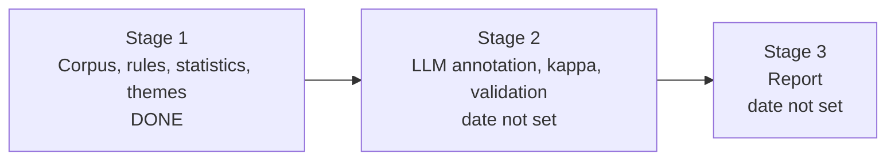

# BRD: How the Data Analyst job changed, 2022 to 2026

Project: `da-job-shift`
Document type: Business Requirements Document
Status: stage 1 of 3 is built and rerun on public data only. Stages 2 and 3 are planned.
Companion document: `TDD.md` (Technical Design Document). Every requirement below points to a TDD section.
Sources used: the code in this repository, `results/*.csv`, and the corpus counts in `results/corpus_meta.json`. No posting text appears in this document.

Reading rule used in this document: **a number from stage 1 is a count of postings that MENTION a thing. It is not proof that the employer REQUIRES it.** Stage 2 separates the two.

---

## 1. Purpose and background

**Purpose.** Give readers evidence, not opinion, about how the Data Analyst job changed between 2022 and 2026. It shows what employers ask for, in the United States and in Vietnam, and it shows a way to measure this from job-posting text.

**Background.**
- ChatGPT appeared on 2022-11-30. The late-2022 market is the "2022 AI baseline".
- The evidence is the text of public job postings. No interviews, no surveys.
- The project is also a learning and portfolio project. It must teach the methods, not only give results. It shows both numeric analysis and text analysis.

---

## 2. The business question

*"How did the Data Analyst role move from the 2022 AI baseline to 2026?"*

The README splits this into three parts:
1. What changed in what employers ask of a Data Analyst between 2022 and 2026? Which tools, tasks, skills and requirements rose or fell?
2. Did the same change happen in the United States and in Vietnam?
3. Where does Vietnam stand against the United States in 2026?

**Why it matters.**
- Skills that rose fast are worth learning first. Skills that fell (for example SAS and SPSS) are worth less.
- AI appears in 16% of Vietnam postings in 2026 and 41% of US postings (mentions). A reader needs to know what kind of AI work employers mean. Stage 2 answers that.
- Vietnam and the US differ in what postings say (English, Power BI, stakeholder work). A reader should not copy US findings into the Vietnamese market.

---

## 3. Stakeholders

| Stakeholder | Role | What they need |
|---|---|---|
| Maintainer | Author of the repository and final decision maker | Clear answers, honest limits, a repository that is safe to publish |
| Readers (hiring managers, peers, learners) | Use the results and the code | Claims they can check; methods explained in plain words; no personal data |
| Data providers (Luke Barousse, Tinix, Internet Archive and the publisher of a public US dataset) | Licensors of the source data | Credit, non-commercial use where required, no redistribution of raw text |
| Annotators in stage 2 (LLM workers, optionally a human) | Label postings with the schema | A written guide, a fixed schema, a way to settle disagreements |

---

## 4. Scope

| Item | Stage 1 (built) | Stage 2 (planned) | Stage 3 (planned) |
|---|---|---|---|
| Build a clean, labelled corpus of postings | In | Reuse | Add optional extra sources |
| Count skills and tools with fixed rules (mentions) | In | Reuse as a check | Report beside stage 2 |
| Compare cells with statistics (US 2022 vs 2026, Vietnam 2022 vs 2026, Vietnam vs US 2026) | In (mentions) | Repeat on annotated fields | Final tables |
| Unsupervised themes | In | None | Read against the taxonomy |
| LLM structured annotation (tasks, AI roles, required vs mentioned) | Schema and guide only | In | Use |
| Two-annotator agreement (Cohen's kappa) | Function only | In | Report |
| Written report | Not started | Not started | In |

**Out of scope**
- Other roles (data engineer, data scientist, business analyst). Their titles are filtered out on purpose.
- Cause. The study shows what changed. It cannot show that AI caused it.
- Salary analysis, forecasts, other countries.
- Collecting postings from live job sites. Only the public downloads listed in `DATA_SOURCES.md` are used.
- Publishing raw posting text or any copy of a source dataset.

---

## 5. Business requirements

Priority uses MoSCoW: Must, Should, Could. "Met by" points to the TDD section.

| ID | Requirement | Priority | Stage | How it is met | TDD | Status |
|---|---|---|---|---|---|---|
| BR-01 | Show how US Data Analyst postings changed from November and December 2022 to 2026 (panel P1) | Must | 1, 2 | Prevalence table for 92 skills with intervals and tests | 3, 4.4 | Mentions done. Required vs mentioned: stage 2 |
| BR-02 | Show how Vietnam Data Analyst postings changed from 2022 to 2026 (panel P2) | Must | 1, 2 | Same method on a smaller sample, with wider intervals | 3, 4.4 | Mentions done. Stage 2 pending |
| BR-03 | Show where Vietnam stands against the US in 2026 (panel P3) | Must | 1, 2 | Same method on a cross-section | 3, 4.4 | Mentions done. Stage 2 pending |
| BR-04 | Separate "required" from "mentioned" for every skill | Must | 2 | Annotation schema field `requirement_level`, guide rules, validation | 4.3 | Schema and guide done. Annotation not run |
| BR-05 | Split AI into roles: tool the analyst uses, product the team builds, governance, data preparation, literacy, company blurb only | Must | 2 | Schema field `ai_roles` with 7 categories and a verbatim quote | 4.3 | Schema and guide done. Annotation not run |
| BR-06 | State how sure each finding is: interval, test, false-discovery control, smallest change the data can see | Must | 1 | Wilson interval, Fisher test, Benjamini-Hochberg, bootstrap, `power_check.csv` | 4.4 | Done for mentions |
| BR-07 | Show that a finding is not an artefact of a different mix, platform or sample size | Must | 1 | Re-weighting, size-matched replication, same-platform panel S1, same-instrument US check | 3, 4.4, 5 | Done for mentions |
| BR-08 | Anyone can try the project without any download | Should | 1 | Synthetic demo data, demo runner, tests on fictional files | 5, 6 | Done |
| BR-17 | Give a general audience an accessible, interactive explanation of the findings | Must | 1 | `report/index.html`: headline shifts, filters, sortable table, themes, method and limits; every number checked against `results/` by a test | 6.4 | Done |
| BR-09 | Find themes nobody planned to look for | Should | 1 | TF-IDF and NMF themes with a stability score | 4.5 | Done. Read in stage 3 |
| BR-10 | Keep personal data and posting text out of git | Must | 1 to 3 | Stripping rules, data folder outside git, `tools/public_safety_check.py` run in the tests and in CI | 2.3, 5 | Done |
| BR-11 | Respect data licences (credit, non-commercial, aggregates only) | Must | 1 to 3 | `DATA_SOURCES.md`, aggregate-only outputs | 2.1, 7 | Done for stage 1 |
| BR-12 | Anyone can rerun the whole pipeline and get the same numbers | Must | 1 to 3 | `run_all.sh`, pinned `requirements.txt`, fixed seeds, 136 test methods | 6 | Done. Two full runs gave the same tables |
| BR-13 | Teach every method in plain words with a worked example | Must | 1 to 3 | TDD section 4 and glossary; plain-words method section in the report page | 4, 9 | Done |
| BR-14 | Write the limits next to every table (small samples, comparability) | Must | 1 to 3 | README section 6, TDD section 7, and a "How to read this" box and limits section in the report page. Repeat in the stage 3 report | 7 | Done for stage 1 |
| BR-15 | Give readers rules for quoting the numbers correctly | Must | 3 | Section 12 of this document, filled with stage 2 numbers | 8 | Draft rules in section 12 |
| BR-16 | Check that longer postings do not fake a rise (rates per 1,000 characters) | Should | 3 | Planned check. Text lengths already in `corpus_summary.csv` | 7, 8 | Not started |

---

## 6. Data requirements and sources

**Needs.**
- Same job family in every cell. Rule: the posting TITLE must be in the Data Analyst family.
- Full posting text, so skills and tasks can be read.
- Two eras: 2022 (US: November and December; Vietnam: the whole year) and 2026.
- Two markets: United States and Vietnam.
- Public sources only, with credits and licences recorded where they exist.
- No personal data and no posting text in anything stored in git.

**The four main cells and the sample sizes** (from `results/panels.json`):

| Cell | Postings | Years | n | Language | Credit and licence |
|---|---|---|---|---|---|
| US_2022 | publicly available US job postings | 2022-11-04 to 2022-12-31 | 2,545 | English | Luke Barousse, Apache 2.0 |
| US_2026 | publicly available US job postings | 2026-01 to 2026-08 | 6,381 | English | public open dataset |
| VN_2022 | publicly available Vietnamese job postings: 45 from a job platform, 96 archived pages | 2022 | 141 | 69% Vietnamese | Tinix, CC BY-NC 4.0; Internet Archive |
| VN_2026 | publicly available Vietnamese job postings from a job platform | 2026 | 242 | 74% Vietnamese | Tinix, CC BY-NC 4.0 |

Extra cells for checks: VN_platform_2022 (45) and VN_platform_2026 (242), the Tinix platform alone.

**Check data.** A same-pipeline US skill check uses Luke Barousse's 2022 file (4,239 postings) and his 2025-2026 release (20,638 postings, 2026-01 to 2026-06). It has skills only, no text.

**Not available, in numbers** (from `DATA_SOURCES.md`): no 2022 Vietnam postings from LinkedIn, no 2026 US text from the same pipeline as 2022, and only 141 Vietnamese 2022 postings in total.

---

## 7. Use cases and the questions the study can answer

| # | Question | Panel | What the answer looks like | Limit |
|---|---|---|---|---|
| UC-1 | Which skills rose or fell in US postings? | P1 | Percent mentioning in each era, difference in points, interval, q-value | Different datasets. See same-instrument check |
| UC-2 | Which skills rose or fell in Vietnam? | P2, S1 | Same, plus year-by-year trend 2022 to 2026 (platform) | 141 postings in 2022. Only large changes show |
| UC-3 | Is Vietnam behind or different from the US in 2026? | P3 | Same, across markets | A difference in market is not a lag in time |
| UC-4 | How is AI mentioned? | All | Share mentioning AI. Stage 2: share by AI role | Stage 1 counts words only |
| UC-5 | Is a skill required or only listed? | All | Stage 2 requirement level per skill | Needs stage 2 |
| UC-6 | What else changed that nobody thought to ask? | P1, P2, P3, S1 | Themes and distinctive words | Exploratory. Suggests only |

**The study cannot answer:** what employers will want in 2027; whether a skill gets a person hired; what a posting is worth in pay; whether postings reflect real work.

---

## 8. Success criteria and acceptance criteria

| # | Criterion | How it is checked | Stage 1 status |
|---|---|---|---|
| AC-1 | Every cell is built with the same cleaning and the same title rule | Code review, `test_build_corpus.py`, `test_common_and_extract.py` | Met |
| AC-2 | Every comparison shows n, interval, effect size, test result and false-discovery q | Column check of `skill_shift_*.csv`, `test_compare_themes_check.py` | Met for 4 panels |
| AC-3 | Every panel states the smallest change it can detect | `power_check.csv` has 3 rows per panel | Met |
| AC-4 | Results hold after re-weighting and size-matching, or the exceptions are named | Columns `weighted_rd_pp` and `size_matched_share_p_lt_05` | Met. Exceptions visible in the tables |
| AC-5 | No e-mail, phone, private path or posting text in committed files | `tools/public_safety_check.py` and `test_public_safety.py` | Met |
| AC-6 | Rerun gives the same tables | `run_all.sh` with fixed seeds | Met (two full runs compared) |
| AC-7 | Stage 2: kappa of 0.60 or higher for each field before the full run | `stats.cohens_kappa` on a double-annotated sample | Pending |
| AC-8 | Stage 2: every annotation record passes validation (schema, quote found in text, taxonomy ids, no personal data) | `validate_annotations.py` (to be written) | Pending |
| AC-9 | Stage 3: every claim in the report is labelled "mentioned" or "required" | Report review | Pending |
| AC-10 | A reader can explain each method in one minute after reading the TDD | Reader feedback | Open |

**Success means:** a reader can say, with numbers and honest limits, what changed in the Data Analyst job in Vietnam and the US.

---

## 9. Assumptions and constraints

**Assumptions**
- The posting title tells whether the job is a Data Analyst family job.
- The Tinix `year` field is correct. It cannot be checked against the original pages.
- The 2022 US dataset is a fair picture of US postings in November and December 2022.
- Text of a posting is a fair proxy for what the employer asks.

**Constraints**

| Type | Constraint | Effect |
|---|---|---|
| Privacy | Posting text and recruiter contacts never enter git | Data lives outside the repository. Only aggregates are committed |
| Licence | Tinix is CC BY-NC 4.0 | Results are CC BY-NC 4.0, so non-commercial use only. Source data is local only and git-ignored. Aggregates only |
| Small samples | VN_2022 has 141 postings. VN_platform_2022 has 45 | Only large changes show. Rare skills cannot be told from zero |
| Comparability | Different sources, platforms, text length and region mix between cells | Weights and checks reduce the problem. They do not remove it |
| Language | Vietnam is about two thirds Vietnamese text. US is English | Word tables and themes run one language at a time |

---

## 10. Risks and mitigations

| # | Risk | Likelihood | Effect | Mitigation | TDD |
|---|---|---|---|---|---|
| R1 | A rise in a skill is only longer postings | Medium | False trend | Rates per 1,000 characters in stage 3. Text lengths already published | 7 |
| R2 | US 2022 and US 2026 differ by pipeline, not by time | Medium | False US trend | Same-instrument check. Report both | 4.4, 5 |
| R3 | Small Vietnam 2022 sample hides real change | High | Missed change | Report the smallest detectable change. Never read "not significant" as "no change" | 4.4 |
| R4 | The regex counts a word that has no skill meaning | Medium | Wrong counts | Context patterns, tests, and stage 2 cross-check | 4.2 |
| R5 | The LLM over-reads a posting (a company blurb becomes "AI as tool") | Medium | Wrong AI split | Verbatim quote rule, validation, kappa, human review under 0.6 confidence | 4.3 |
| R6 | Personal data or private data leaks into a committed file | Low | Privacy harm | Stripping rules, data folder outside git, public-safety guard in tests and CI | 2.3, 5 |
| R7 | A source licence turns out to forbid the use | Low | Cell must go | Keep each cell separate so one can be dropped and the rest rerun | 2.1 |
| R8 | A reader over-trusts a result | Medium | Wrong conclusions | Plain limits beside each table. "Mentions" label | 7 |
| R9 | Stage 2 cost or time is larger than expected | Medium | Delay | Pilot on a sample first. Open question 2 | 4.3 |
| R10 | A source changes or disappears after the download date | Medium | Rerun differs | Keep the date and file hash of your own copy | 6 |

---

## 11. Deliverables and timeline

| # | Deliverable | Path | Stage | Status |
|---|---|---|---|---|
| D1 | README (question, design, method, findings, glossary) | `README.md` | 1 | Done |
| D2 | Data source record | `DATA_SOURCES.md` | 1 | Done |
| D3 | Taxonomy (91 skills, 14 groups) | `taxonomy/skills.yaml` | 1 | Done |
| D4 | Pipeline code and 136 test methods | `src/`, `tests/` | 1 | Done |
| D5 | Aggregated results and 8 figures | `results/` | 1 | Done |
| D6 | Annotation schema and guide | `schema/`, `docs/ANNOTATION_GUIDE.md` | 1 (design), 2 (use) | Designed |
| D7 | BRD and TDD | `docs/BRD.md`, `docs/TDD.md` | 1 | Done |
| D8 | Safety guard, synthetic demo (the download scripts are not published) | `tools/`, `examples/` | 1 | Done |
| D9 | Interactive report page for a general audience (static HTML, publishable with GitHub Pages) | `report/index.html`, `scripts/build_report.py`, `docs/PUBLISHING.md` | 1 | Done |
| D10 | Annotated corpus, kappa report, validator | not yet created | 2 | Not started |
| D11 | Final written report | not yet created | 3 | Not started |

Plain description: three boxes in a row. Stage 1 is finished. Stage 2 follows it. Stage 3 follows stage 2. No dates are set for stages 2 and 3 (open question 1).

---

## 12. How to read and quote the results

These are rules for stage 3. The numbers below are stage 1 mentions and may change after stage 2.

1. Say "mention", never "require". Example: "in a sample of 242 Vietnamese postings from 2026, 57% mention Power BI". Not: "57% of employers require Power BI".
2. Name the sample next to the number (cell, period, n). A market is not a sample of it.
3. Quote the direction before the size. Directions agree across checks (P2 and S1; P1 and the same-instrument check). Sizes differ.
4. For Vietnam 2022, report the interval. With 141 postings only changes of about 9 to 15 points or more can show.
5. Skills that rose in both Vietnamese panels (dashboards, Power BI, SQL, Tableau, data quality) and fell (SAS, SPSS/Stata) are the safest headline findings.
6. AI: in 2026, 16.1% of Vietnam postings and 41.1% of US postings mention it. Stage 2 will say which are tool use, product work or company blurb. Until then, do not say what kind of AI work employers want.

---

## 13. Open questions

1. Dates: when should stage 2 and stage 3 finish? No dates are set.
2. Stage 2 size: the plan says annotate every posting in the four main cells (9,309) and double-annotate 20%. That is about 11,200 model calls. The US cells are large and already have narrow intervals. Annotate only a sample of the US cells (for example 1,000 per cell) and all of Vietnam (383)? This is a recommendation, not a plan.
3. Is the question wording in section 2 the one to keep?
4. The Vietnamese theme tables are produced locally but not published. Publish them later, after review?
